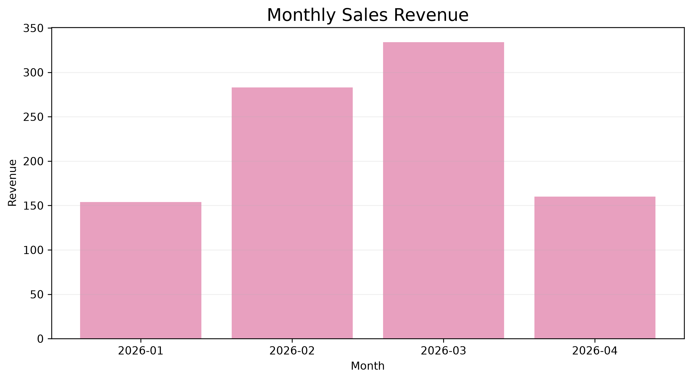
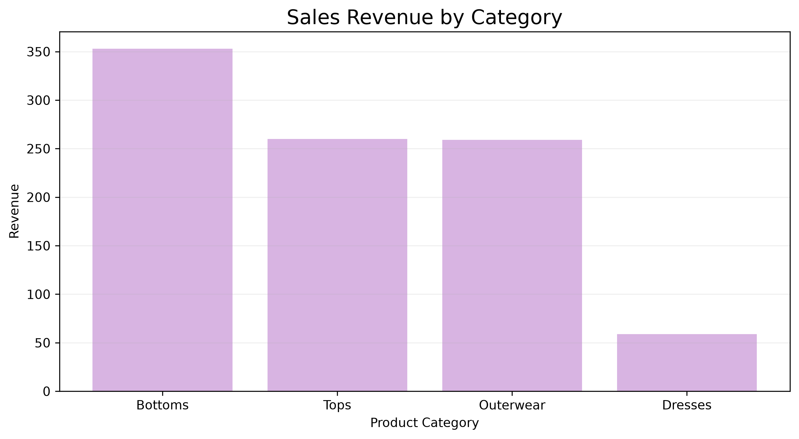
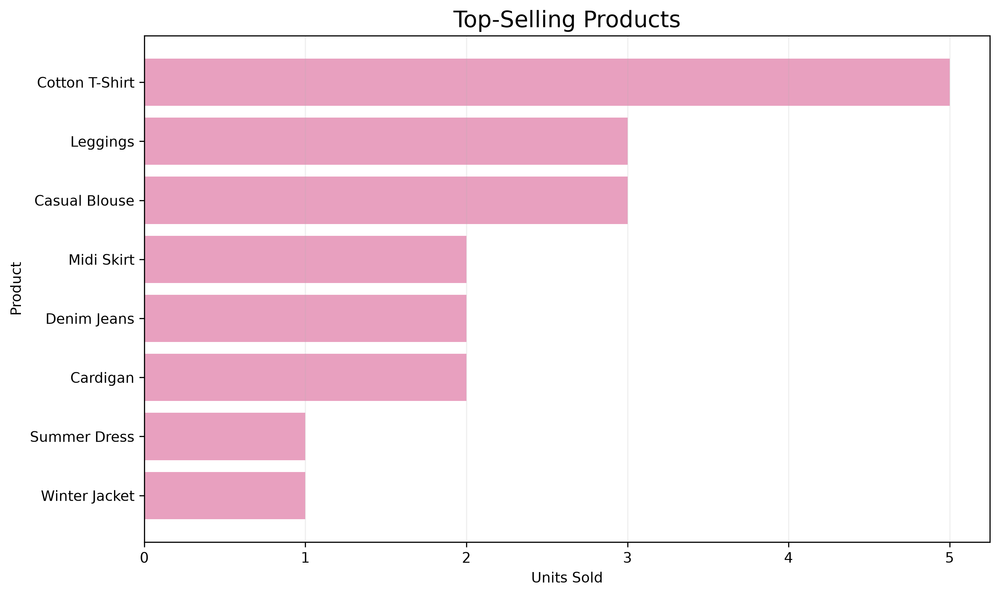
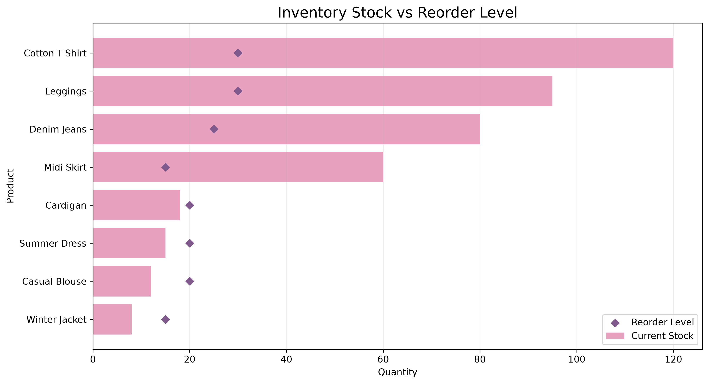

# Retail Sales & Inventory Analysis

## Project Overview

This project analyzes retail sales, customer purchasing behavior, and inventory levels using Oracle SQL and Python.

The goal is to identify sales trends, best-selling products, and products that require restocking.

The project uses a small sample retail dataset created for portfolio demonstration purposes.

## Tools & Technologies

- Oracle SQL / Oracle APEX
- Python
- Pandas
- Matplotlib
- Visual Studio Code

## Database Structure

The relational database contains five tables:

1. Customers
2. Products
3. Orders
4. Order Items
5. Inventory

SQL scripts are available in the `sql/` folder.

## SQL Analysis

Five analyses were performed:

1. Monthly Sales Revenue
2. Top-Selling Products
3. Sales by Product Category
4. Customer Purchase Analysis
5. Inventory Stock Analysis

The SQL queries use JOIN, GROUP BY, SUM, COUNT, CASE, and ORDER BY.

## Data Visualization

### 1. Monthly Sales Revenue



Monthly revenue reached its highest value in March 2026.

### 2. Sales by Category



This chart compares revenue across product categories.

### 3. Top-Selling Products



Cotton T-Shirt recorded the highest number of units sold.

### 4. Inventory Analysis



The analysis compares current stock quantities with reorder levels to identify products that require restocking.

## Key Findings

- Total completed-order revenue: 931
- March 2026 generated the highest monthly revenue: 334
- Cotton T-Shirt was the best-selling product by units sold.
- Four products were identified as requiring restocking.
- Sales and inventory analysis can support purchasing and inventory planning decisions.

## Project Structure

```text
retail-sales-inventory/
├── charts/
│   ├── monthly_sales.png
│   ├── sales_by_category.png
│   ├── top_selling_products.png
│   └── inventory_analysis.png
├── data/
│   ├── customer_analysis.csv
│   ├── inventory_analysis.csv
│   ├── monthly_sales.csv
│   ├── order_items_data.csv
│   ├── sales_by_category.csv
│   └── top_selling products analysis.csv
├── python/
│   └── create_charts.py
├── sql/
│   ├── analysis.sql
│   ├── create_tables.sql
│   └── insert_data.sql
└── README.md
```

## How to Run

1. Create the database tables using `sql/create_tables.sql`.
2. Insert the sample data using `sql/insert_data.sql`.
3. Run the analysis queries in `sql/analysis.sql`.
4. Install Python dependencies:

```bash
pip install pandas matplotlib
```

5. Generate the charts:

```bash
python python/create_charts.py
```

## Business Applications

This project demonstrates how SQL and Python can be used to support retail reporting, product performance analysis, and inventory replenishment decisions.

It combines data analytics skills with practical retail and merchandising knowledge.
